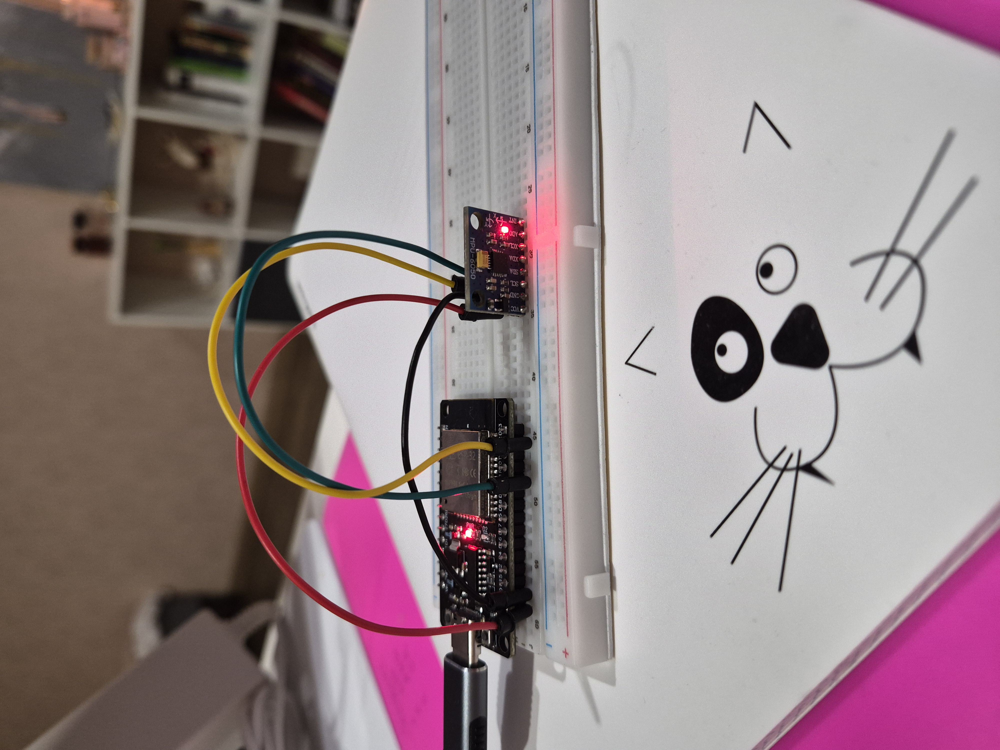

# HW01. Бизнес-анализ

**Краткое описание проекта** 

Система мониторинга производственной безопасности смены + прототип носимой системы мониторинга.

Прототип: девайс (ESP32 + MPU6050), который крепится на запястье и с помощью модели распознаёт режим: покой, движение без инструмента, шуруповёрт, молоток или перфоратор. 

Также, считается длительность режима и результат отображается на дашборде. Если срабатывает заранее заданное правило (превышена длительность работы с виброинструментом, слишком долго в покое), на экране появляется предупреждение.

---

## 1. Бизнес-анализ (Business Understanding)

### Организационная структура

| Роль | Кто | Что делает |
|---|---|---|
| Разработчик, носитель устройства | автор, позже по возможности ещё 1–2 человека | Сбор данных, модель, дашборд, текст и защита, запись сессий с инструментом |
| Наставник | Преподаватель | Консультации, разбор / првоерка дз |
| Пользователь веб-сервиса | специалист по охране труда или мастер смены / пропраб | Смотрит время по режимам и предупреждения |

### Бизнес-цель

Снизить потери предприятия от того, что опасное состояние работника замечают слишком поздно.

### Экономическая выгода

**Снижение расходов на больничные и замещение:** долгая работа виброинструментом связана с риском проф. заболеваний. Для предприятия это больничный, поиск замены, обучение другого человека и простой участка. Система видит, кто и как долго работает конкретным инструментом. Если вибрационная активность или длительность выделяются на фоне остальных, руководитель получает сигнал и может переложить часть операций.

**Снижение тяжести последствий происшествий:** падение, потеря сознания или состояние, в котором человек не может сам позвать на помощь, тем дороже, чем позже о них узнают. Эффект — более короткое время обнаружения и меньшая тяжесть последствий.

**Меньше ручного контроля охраны труда:** часть картины сейчас собирают журналами, опросами, обходами и периодическими замерами. Автоматический сбор даёт статистику по инструментам, длительность операций, историю событий, показатель вибрационной активности и уведомления. Меньше ручной сводки и прозрачнее контроль.

Целевые площадки: промышленные предприятия, стройка, шахты и удалённые объекты, где камеры неудобны или нежелательны.

### Существующие решения

| Решение | Чем не закрывает задачу прототипа |
|---|---|
| Аттестованный виброметр | Дорогой прибор под единичные замеры (нет детальной аналитики по смене).|
| Промышленные браслеты вибрационной экспозиции | Личный измеритель на одном человеке. Меряет его дозу и показывает только ему. Нет общего дашборда по смене. Не видно, кто из всех сейчас долго на тяжёлом инструменте или долго неподвижен. |
| Обычные часы и фитнес-браслеты | Нет классификации инструмента и нет аналитики активности смены |

### В чём преимущество 

Узел сидит на запястье всю смену и смотрит непрерывно. Предупреждение уходит ответственному в момент события, пока ещё можно снять человека с инструмента или подойти к нему. Два правила:

- слишком долго на тяжёлом виброинструменте;
- слишком долго нет движения.

---

## 1.1. Текущая ситуация (Assessing current solution)

### Ресурсы

Железо для сбора:
- ESP32 Dev Module;
- MPU6050 (акселерометр и гироскоп);
- макетная плата и провода

Уже сделала првоерку, что MPU работает при 200 Гц, т.е. датасет будет собиратсья с 200-ми показаниями в секунду. 

Инструменты: молоток, шуруповёрт, перфоратор.

Данные: записать отдельные csv на каждую сессию (с инструментами и в покое), на выходе будут временные сигналы (какое ускорение было в каждый момент времени),разметить, применить преобразование Фурье, чтобы получить частоты.

### Риски и что с ними делать

| Риск | Почему реален | Что делаем |
|---|---|---|
| Не уложиться в сроки | До защиты 15–19 февраля 2027 нужно успеть данные, модель и экран. Дашборд легко раздуть | Сначала устойчивый CSV и пять классов. Дашборд читает уже посчитанные сессии.|
| Мало или грязные данные | Один человек, одно крепление, похожие соседние окна | 10 записей по 30–60 секунд на класс — только старт. Дальше другие дни, материалы и режимы. Train и test режутся целыми записями и днями, не случайными окнами |
| Классы не различаются | Шуруповёрт без нагрузки похож на покой, удар молотка по мягкому — на движение руки | В метаданных писать режим и материал. Смотреть спектр и примеры ошибок. Слабый класс честно сузить, а не дотягивать точность смесью окон одной записи |

---

## 1.2. Решаемые задачи с точки зрения аналитики (Data Mining goals)

Задача многоклассовой классификации.

Всего планируется 5 классов: `drill`, `hammer`, `perforator`, `idle`, `hand_motion`.

**Метрика.** 
Поскольку, для обычной многоклассовой классификации F1-micro =Accuracy, лучше смотреть ещё и на F1-macro.
F1-macro сможет показать, есть ли проблема с каким-то из классов. По идее, каждый инструмент одинаково важен. Классы скорее всего получается сбалансированные, т.к. датасет кастомный, поэтому можно смотреть и accuracy. Но F1 важнее + матрица ошибок по классам. 

**Критерий успеха.**

| Уровень | Macro-F1 | Зачем порог |
|---|---|---|
| Минимальный | 0,70 | Прототип отличает режимы лучше, чем предсказание самого частого класса |
| Целевой | 0,85 | Ошибки редкие |

Отдельно, если модель будет перепредсказывать перфоратор, можно посмотреть Precision по перфоратору.

Пороги предварительные. 

Правило предупреждения на дашборде — продуктовое, не метрика.

---

## 1.3. План проекта (Project Plan)

1. Сформулировать задачу (понять, что из себя представляет прототип. Какие цели и возможности у проекта. Определиться с метриками.) 

2. Изучение данных (Получить несколько csv по каждому классу и сессии.)

3. Подготовка данных (Собрать все сессии, инструменты в один датасет, произвести необходимые преобразования).

4. Моделирование (создать бейзлайн, далее добавить другие модели. скорее всего классик ML, возможно попробовать нейронку)

5. Оценка качества (прошить микроконтроллер, проверить на отложенной выборке, попробовать квантизацию - не потеряется ли качество)

6. Создание веб-интерфейса (веб-приложение с аналитикой)
